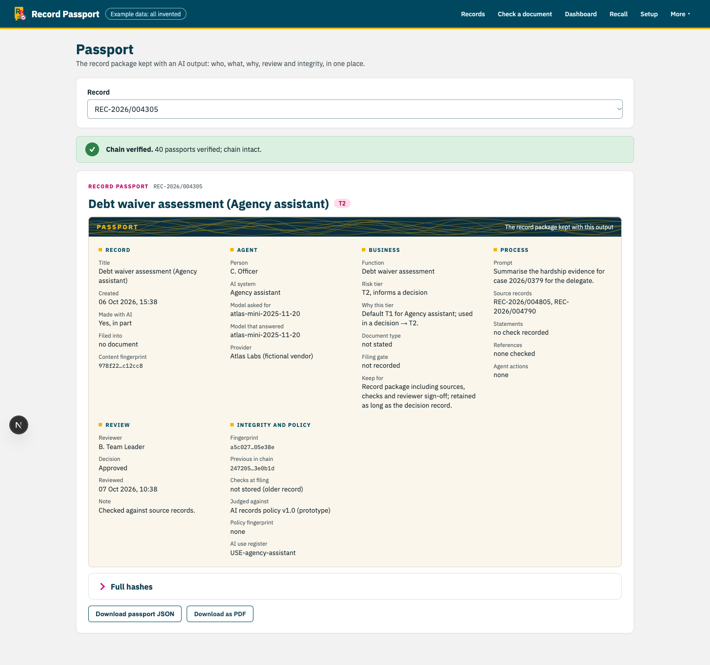
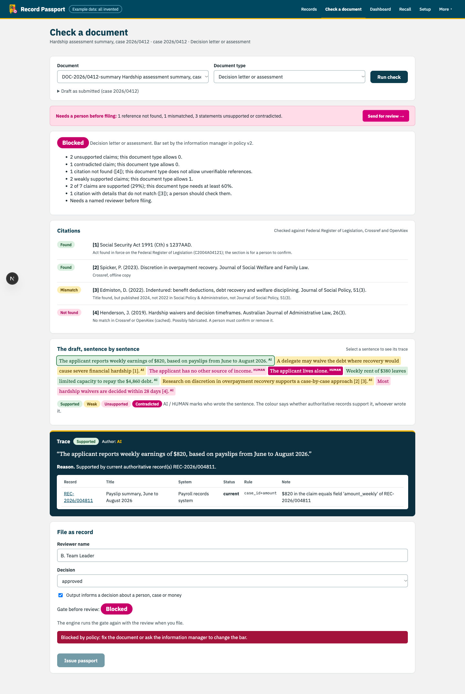
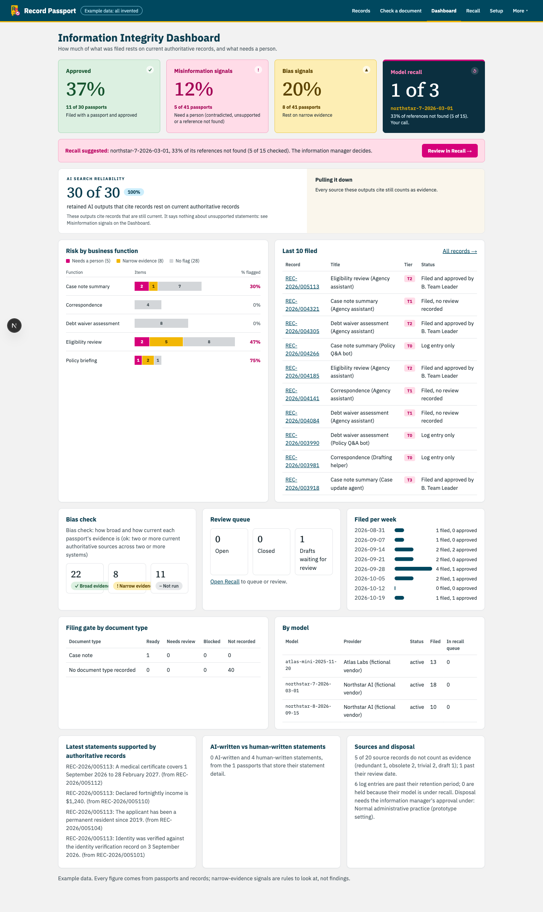
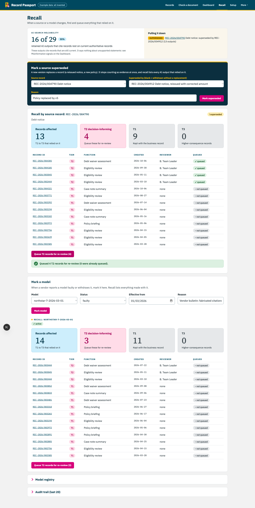

# Record Passport

**Finalist, RIMPA Global Hackathon 2026** (sponsored by the National Archives of Australia)

> *How might we build information management know-how into AI so that organisations can better
> recognise and manage bias, misinformation and disinformation?*

Record Passport decides what to trust from the evidence, not from whether AI touched a document. When an
AI-assisted document becomes a government record, it does four things:

1. **Checks citations.** It looks up every reference in Crossref and OpenAlex. Each one comes back as found, mismatch, not found or not checked.
2. **Weighs the evidence.** It traces each sentence back to authoritative source records. Each sentence comes back as supported, weak, unsupported or contradicted. AI-written and human-written sentences get the same test.
3. **Issues a passport.** It files a record package covering who, what, which model, why, how and who reviewed it. The package is tiered by the National Archives of Australia's risk rule and sealed into a hash chain.
4. **Recalls.** If a model is later found faulty, or a source record is superseded, it finds every record that depended on it and queues the risky ones for re-review.

**Live app:** [record-check.vercel.app](https://record-check.vercel.app). It runs on invented example data.



| Check a document | Information manager dashboard | Recall |
|---|---|---|
|  |  |  |

## How it's built

```
web/                      Next.js (TypeScript) app; types generated from the API's OpenAPI schema
prototype/record-check/
  recordcheck/            the engine: a plain Python package with no UI code
  api/                    FastAPI wrapper, deployed as Vercel functions
  app/                    Streamlit console (used for the stage demo)
  tests/                  pytest suite (284 tests), runs fully offline
docs/                     decision log, version log, screenshots
```

- **The engine enforces the rules, not the UI.** The filing gate, tier floor and reviewer/author separation
  are checked inside the engine. The API re-derives citations and verdicts instead of trusting what a
  caller sends. This means any system that plugs in gets the same guarantees.
- **The model stays out of the accuracy path.** Claude is used only to split text into claims, and there is
  a deterministic offline fallback. Lookups, linking rules, tiering and hashing are all plain, tested
  Python.
- **Everything works offline.** Seed data and cached lookups mean the demo and the tests never need a
  network or an API key. Live Crossref, OpenAlex and the LLM are upgrades, never requirements.
- **Edge cases are tracked.** [`EDGE_CASES.md`](prototype/record-check/EDGE_CASES.md) lists every edge case,
  and a test fails if the list and the code drift apart.
- **Storage:** SQLite locally, Postgres (Neon) in production, with a separate database branch for the stage
  demo so rehearsals never touch real data.

Module contracts are in [`ARCHITECTURE.md`](prototype/record-check/ARCHITECTURE.md). Why each call was made
is in the [decision log](docs/decisions.md), and what shipped when is in the [version log](docs/versions.md).

## Run it

```bash
cd prototype/record-check
uv sync
uv run pytest -q                                   # offline, no key needed
uv run uvicorn api.main:app --reload               # API at http://127.0.0.1:8000/docs
uv run streamlit run app/streamlit_app.py          # console
```

```bash
cd web && npm install && npm run dev               # web app (expects the API on :8000)
```

## Team and credits

Built in three days for RIMPA Live 2026 (19–21 October, Sydney) by a team of three. **Hasim Rahman** was
the data engineer and sole developer; two technology consultants led the storytelling and the
records-management research.

The commit history here is the product code, extracted from the team's working repo.
